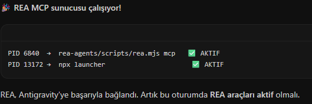
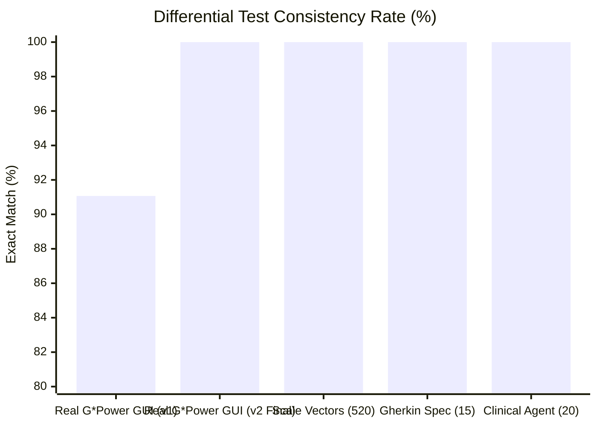
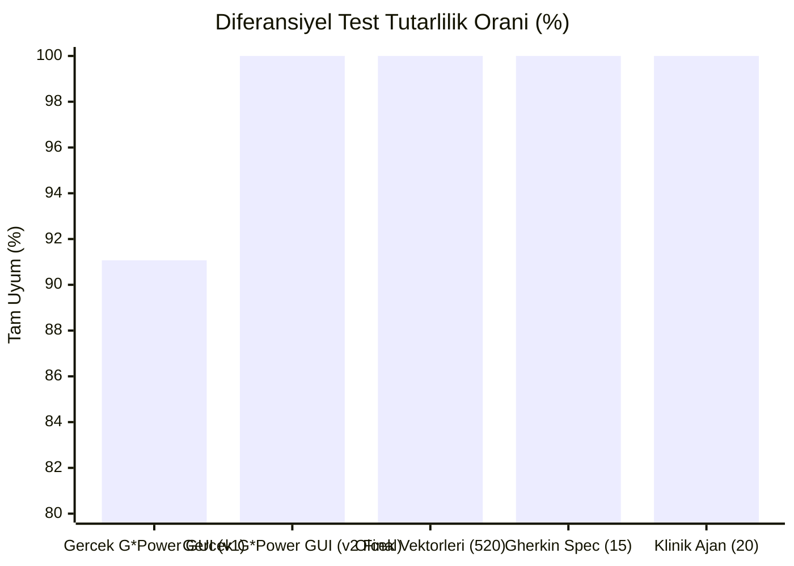

# GPower CLI-API (t-paired)

This project was developed for the **Software Implementation and Testing (Yazılım Gerçekleme ve Test)** course taught by **Dr. Nurettin Şenyer** ([@seyyah](https://github.com/seyyah)). It is a clean-room reimplementation of the paired-samples t-test calculation engine (`t-paired`) as a command-line tool, MCP server, HTTP API, and clinical agent.

**Implemented Layers:** CLI + MCP Server + AI Agent (Topic 2: Paired Samples t-Test)  
**Target Binary:** `GPowerNT.exe` (v3.1.9.7, Build 143) — SHA-256: `c63e6a133eb6372932f810c08cc33dc35a06d1ddb658f897bd6c34a754efc812`  
**60s CLI Demo Video:** [https://www.youtube.com/watch?v=n7ZluNtJA0E](https://www.youtube.com/watch?v=n7ZluNtJA0E)

---

## Purpose of the Assignment

Statistical power analysis tools used in healthcare and clinical research mostly rely on desktop graphical interfaces (GUI). For an AI agent to use a GUI-only tool, it has to take screenshots and click coordinates on the screen, which consumes thousands of tokens per query and is prone to reading errors.

The main goal of this assignment is to reverse the traditional workflow (going from binary code to evidence, from evidence to specification, and from specification to clean code) and bring this calculation engine into the agent era by placing it behind a low-token CLI, an MCP server, and a natural-language agent interface.

## Assigned Task & Teardown Setup (Topic 2)

Our team was assigned **Topic 2: Paired Samples t-Test (`t-paired` - difference between two dependent means, e.g., pre- and post-treatment blood pressure)** for both **a-priori** (computing required sample size `N`) and **post-hoc** (computing achieved statistical power) modes.

1. **REA & Ghidra Setup Verification:** Connected `rea-agents` MCP server and Ghidra 12.1.4 to inspect `GPowerNT.exe`.
   
2. **Evidence & Specification:** Extracted the exact root-finding (`0x4f9bb0`), 10-decimal pre-rounding ceiling rule (`0x496a20`), sign rules (`0x4d38b0`), and input bounds into [`LEDGER.md`](LEDGER.md) and [`SPEC.md`](SPEC.md).
3. **Clean-Room Reimplementation:** Built the calculation engine, CLI (`gpower-clone`), MCP server, HTTP API, and clinical agent in [`src/`](src/).
4. **Real G\*Power Oracle Verification:** Automated the original G\*Power 3.1.9.7 desktop app to capture 56 real reference vectors and screenshots ([`oracle/screenshots/`](oracle/screenshots/)), plus 520 scale vectors ([`oracle/scale_500_vectors.csv`](oracle/scale_500_vectors.csv)).

---

## Consistency & Differential Test Results

Running our engine against the real **G\*Power 3.1.9.7 GUI Oracle** (56 vectors with screenshots) initially achieved **91.07% (51/56)** exact match, exposing two subtle binary behaviors (negative `Critical t` sign when `dz < 0` and `min N = 2` in `a-priori` mode, documented in [`HALLUCINATIONS.md`](HALLUCINATIONS.md)). After applying these two fixes, the engine achieved **100.00% consistency** across all suites:



| Verification Suite | Evaluated Vectors | Initial Pass (v1) | Final Pass (v2) | Tolerance | Report / Evidence |
| :--- | :---: | :---: | :---: | :---: | :--- |
| **Real G\*Power 3.1.9.7 GUI Oracle** | 56 (36 GP + 20 SC) | 91.07% (51/56) | **100.00% (56/56)** | Exact `N`, `df` & GUI decimals | [`oracle/ORACLE_REPORT.md`](oracle/ORACLE_REPORT.md) |
| **Scale Grid Vectors** | 520 | 100.00% (520/520) | **100.00% (520/520)** | Exact `N`, `df` & `<= 1e-6` | [`tests/DIFFERENTIAL_REPORT.md`](tests/DIFFERENTIAL_REPORT.md) |
| **Gherkin Spec Scenarios** | 15 | 100.00% (15/15) | **100.00% (15/15)** | Exact match | [`SPEC.md`](SPEC.md) |
| **CLI == MCP Equivalence** | 4 | 100.00% (4/4) | **100.00% (4/4)** | Bit-for-bit JSON match | [`tests/test_cli_mcp_agent.py`](tests/test_cli_mcp_agent.py) |
| **Clinical Agent Benchmark (TR/EN)** | 20 (10 TR + 10 EN) | 100.00% (20/20) | **100.00% (20/20)** | Exact family & `N` (~94.6% fewer tokens vs GUI) | [`tests/agent_benchmark_results.json`](tests/agent_benchmark_results.json) |

---

## How to Use

No external library installation is required to run the core engine, CLI, MCP server, or agent (Python 3.10+ standard library is sufficient).

### 1. CLI Usage

**A-priori mode (calculate required sample size N):**
```bash
python src/cli.py --test t-paired --mode a-priori --tails 2 --dz 0.5 --alpha 0.05 --power 0.95
```
On Windows, you can also use the batch wrapper directly:
```powershell
.\gpower-clone.bat --test t-paired --mode a-priori --tails 2 --dz 0.5 --alpha 0.05 --power 0.95
```
Output (single-line JSON):
```json
{"n_total":54,"actual_power":0.950212,"critical":2.005746,"df":53,"ncp":3.6742346}
```

**Post-hoc mode (calculate achieved power):**
```bash
python src/cli.py --test t-paired --mode post-hoc --tails 2 --dz 0.5 --alpha 0.05 --n 34
```

**Calculating directly from pre/post group parameters (mean1, mean2, sd1, sd2, corr):**
```bash
python src/cli.py --test t-paired --mode a-priori --tails 2 --mean1 140 --mean2 136 --sd1 10 --sd2 10 --corr 0.5 --alpha 0.05 --power 0.90
```

### 2. Clinical Agent Usage

To ask a clinical question in natural language (Turkish or English):
```bash
python src/agent.py "Aynı hastalarda tedavi öncesi ve sonrası tansiyon için dz = 0.5, alpha = 0.05 ve %80 güç ile çift yönlü testte kaç hasta gerekir?"
```

To run the 10-question benchmark set:
```bash
python src/agent.py --benchmark
```

### 3. MCP Server and HTTP API Usage

To start the MCP server (JSON-RPC 2.0 over stdio):
```bash
python src/mcp_server.py
```

**MCP Tool Schema (`calculate_t_paired`):**
- **Inputs:** `mode` (`"a-priori"` | `"post-hoc"`, required), `tails` (`1` | `2`, default `2`), `alpha` (`float`, default `0.05`), `dz` (`float`, or `mean_dz`/`sd_dz`, or `mean1`/`mean2`/`sd1`/`sd2`/`corr`), `power` (`float`, required for `a-priori`), `n` (`int`, required for `post-hoc`).
- **Outputs:** `n_total` (`int`), `actual_power` (`float`), `critical` (`float`), `df` (`int`), `ncp` (`float`), `dz` (`float`). Full specification in [`CONTRACT.md`](CONTRACT.md).

To start the local HTTP REST API server:
```bash
python src/api_server.py --port 8080
```

### 4. Running Tests

```bash
python -m unittest discover -s tests -v
python tests/test_oracle_real_differential.py
```

## References and Attribution

This project was created for the **Yazılım Gerçekleme ve Test** course given by **Dr. Nurettin Şenyer** (https://github.com/seyyah).  
Reference statistical software and methodology:
- Faul, F., Erdfelder, E., Lang, A.-G., & Buchner, A. (2007). *G\*Power 3: A flexible statistical power analysis program for the social, behavioral, and biomedical sciences.* Behavior Research Methods, 39, 175-191.
- Faul, F., Erdfelder, E., Buchner, A., & Lang, A.-G. (2009). *Statistical power analyses using G\*Power 3.1: Tests for correlation and regression analyses.* Behavior Research Methods, 41, 1149-1160.

---

# GPower CLI-API (t-paired) - Türkçe

Bu proje, **Dr. Nurettin Şenyer** ([@seyyah](https://github.com/seyyah)) tarafından verilen **Yazılım Gerçekleme ve Test** dersi ödevi kapsamında geliştirilmiştir. Eşleştirilmiş örneklem t-testi (`t-paired`) hesaplama motorunun temiz oda (clean room) kurallarıyla komut satırı aracı (CLI), MCP sunucusu, HTTP API ve klinik ajan olarak yeniden yazılmış halidir.

**Gerçekleştirilen Katmanlar:** CLI + MCP Sunucusu + AI Ajanı (2. Konu: Eşleştirilmiş Ortalama t-Testi)  
**İncelenen Binary:** `GPowerNT.exe` (v3.1.9.7, Build 143) — SHA-256: `c63e6a133eb6372932f810c08cc33dc35a06d1ddb658f897bd6c34a754efc812`  
**60 Saniyelik CLI Demo Videosu:** [https://www.youtube.com/watch?v=n7ZluNtJA0E](https://www.youtube.com/watch?v=n7ZluNtJA0E)

---

## Ödevin Amacı

Sağlık ve klinik araştırmalarda kullanılan istatistiksel güç analizi araçları genellikle yalnızca grafik arayüz (GUI) üzerinden çalışır. Bir yapay zeka ajanının sadece arayüzü olan bir programı kullanabilmesi için sürekli ekran görüntüsü alması ve ekranda tıklama yapması gerekir. Bu durum her sorguda binlerce token harcanmasına ve okuma hatalarına yol açar.

Bu ödevin amacı; klasik yazılım geliştirme sürecini tersine çevirerek (koddan kanıta, kanıttan spesifikasyona ve oradan temiz koda giderek) mevcut hesaplama motorunu az token harcayan bir CLI, bir MCP sunucusu ve doğal dille soru sorulabilen bir ajan yapısının arkasına taşımaktır.

## Ödev İçin İstenilen Görev ve Kurulum Doğrulaması (2. Konu)

Takımımıza **2. Konu: t testi, eşleştirilmiş ortalama (önce ve sonra tansiyon)** test ailesinin **a-priori** (örneklem büyüklüğü `N` hesaplama) ve **post-hoc** (ulaşılan gücü hesaplama) modları verilmiştir.

1. **REA ve Ghidra Kurulum Kontrolü:** `GPowerNT.exe` analizi için `rea-agents` MCP sunucusu ve Ghidra 12.1.4 bağlantısı doğrulandı.
   
2. **Kanıt Defteri ve Spesifikasyon:** Kök bulma (`0x4f9bb0`), 10 ondalık ön-yuvarlamalı tavan kuralı (`0x496a20`), kritik değer işaret kuralı (`0x4d38b0`) ve sınır kontrolleri kanıtlarıyla [`LEDGER.md`](LEDGER.md) ve [`SPEC.md`](SPEC.md) dosyalarına çıkarıldı.
3. **Temiz Oda Yeniden Yazım:** Yalnızca `SPEC.md` referans alınarak hesaplama motoru, CLI (`gpower-clone`), MCP sunucusu, REST API ve klinik ajan [`src/`](src/) altında sıfırdan kodlandı.
4. **Gerçek G\*Power Kâhin Doğrulaması:** Orijinal G\*Power 3.1.9.7 masaüstü uygulaması otomatikleştirilerek 56 gerçek vektör ve ekran görüntüsü ([`oracle/screenshots/`](oracle/screenshots/)) ile 520 ölçek vektörü ([`oracle/scale_500_vectors.csv`](oracle/scale_500_vectors.csv)) üzerinde test edildi.

---

## Tutarlılık ve Diferansiyel Test Sonuçları

Motorumuzun gerçek **G\*Power 3.1.9.7 GUI Kâhini** (56 ekran görüntülü vektör) ile yapılan ilk karşılaştırmasında **%91.07 (51/56)** birebir uyum elde edilmiş; fark çıkan 5 vektör sayesinde 2 gizli davranış ($d_z < 0$ için negatif `Critical t` işareti ve `a-priori` modda `min N = 2` sınırı — bkz. [`HALLUCINATIONS.md`](HALLUCINATIONS.md)) yakalanmıştır. Bu iki düzeltme sonrasında tüm test setlerinde **%100.00 tutarlılık** sağlanmıştır:



| Doğrulama Katmanı / Veri Seti | Vektör Sayısı | İlk Tur (v1) | Final (v2) Uyum Oranı | Tolerans | Rapor / Kanıt |
| :--- | :---: | :---: | :---: | :---: | :--- |
| **Gerçek G\*Power 3.1.9.7 GUI Kâhini** | 56 (36 GP + 20 SC) | %91.07 (51/56) | **%100.00 (56/56)** | Tam `N`, `df` ve GUI basamağı | [`oracle/ORACLE_REPORT.md`](oracle/ORACLE_REPORT.md) |
| **Ölçek Vektörleri (Scale Grid)** | 520 | %100.00 (520/520) | **%100.00 (520/520)** | Tam `N`, `df` ve `<= 1e-6` | [`tests/DIFFERENTIAL_REPORT.md`](tests/DIFFERENTIAL_REPORT.md) |
| **Gherkin Spec Senaryoları** | 15 | %100.00 (15/15) | **%100.00 (15/15)** | Birebir eşleşme | [`SPEC.md`](SPEC.md) |
| **CLI == MCP Eşdeğerlik Testi** | 4 | %100.00 (4/4) | **%100.00 (4/4)** | Birebir aynı JSON çıktı | [`tests/test_cli_mcp_agent.py`](tests/test_cli_mcp_agent.py) |
| **Klinik Ajan Değerlendirme Seti (TR/EN)** | 20 (10 TR + 10 EN) | %100.00 (20/20) | **%100.00 (20/20)** | Doğru aile ve `N` (GUI'ye göre ~%94.6 token tasarrufu) | [`tests/agent_benchmark_results.json`](tests/agent_benchmark_results.json) |

---

## Kullanım

Uygulamayı çalıştırmak için harici bir kütüphane kurulumuna gerek yoktur (Python 3.10+ standart kütüphanesi yeterlidir).

### 1. CLI Kullanımı

**A-priori modu (gereken örneklem büyüklüğü N hesabı):**
```bash
python src/cli.py --test t-paired --mode a-priori --tails 2 --dz 0.5 --alpha 0.05 --power 0.95
```
Windows üzerinde doğrudan `.bat` dosyasıyla da çalıştırabilirsiniz:
```powershell
.\gpower-clone.bat --test t-paired --mode a-priori --tails 2 --dz 0.5 --alpha 0.05 --power 0.95
```
Beklenen çıktı (tek satır JSON):
```json
{"n_total":54,"actual_power":0.950212,"critical":2.005746,"df":53,"ncp":3.6742346}
```

**Post-hoc modu (ulaşılan istatistiksel güç hesabı):**
```bash
python src/cli.py --test t-paired --mode post-hoc --tails 2 --dz 0.5 --alpha 0.05 --n 34
```

**Önce ve sonra grup parametrelerinden (mean1, mean2, sd1, sd2, corr) doğrudan hesaplama:**
```bash
python src/cli.py --test t-paired --mode a-priori --tails 2 --mean1 140 --mean2 136 --sd1 10 --sd2 10 --corr 0.5 --alpha 0.05 --power 0.90
```

### 2. Klinik Ajan Kullanımı

Doğal dille (Türkçe veya İngilizce) soru sormak için:
```bash
python src/agent.py "Aynı hastalarda tedavi öncesi ve sonrası tansiyon için dz = 0.5, alpha = 0.05 ve %80 güç ile çift yönlü testte kaç hasta gerekir?"
```

10 soruluk değerlendirme setini çalıştırmak için:
```bash
python src/agent.py --benchmark
```

### 3. MCP Sunucusu ve HTTP API Kullanımı

MCP sunucusunu başlatmak için (stdio üzerinden JSON-RPC 2.0):
```bash
python src/mcp_server.py
```

**MCP Araç Şeması (`calculate_t_paired`):**
- **Girdi Alanları:** `mode` (`"a-priori"` | `"post-hoc"`, zorunlu), `tails` (`1` | `2`, varsayılan `2`), `alpha` (`float`, varsayılan `0.05`), `dz` (`float`, veya `mean_dz`/`sd_dz`, veya `mean1`/`mean2`/`sd1`/`sd2`/`corr`), `power` (`float`, `a-priori` için zorunlu), `n` (`int`, `post-hoc` için zorunlu).
- **Çıktı Alanları:** `n_total` (`int`), `actual_power` (`float`), `critical` (`float`), `df` (`int`), `ncp` (`float`), `dz` (`float`). Tam şema [`CONTRACT.md`](CONTRACT.md) içindedir.

Yerel HTTP REST API sunucusunu başlatmak için:
```bash
python src/api_server.py --port 8080
```

### 4. Testleri Çalıştırma

```bash
python -m unittest discover -s tests -v
python tests/test_oracle_real_differential.py
```

## Kaynakça ve Atıf

Bu proje, **Dr. Nurettin Şenyer** (https://github.com/seyyah) tarafından yürütülen **Yazılım Gerçekleme ve Test** dersi kapsamında eğitim amacıyla oluşturulmuştur.  
İncelenen orijinal aracın yazarları:
- Faul, F., Erdfelder, E., Lang, A.-G., & Buchner, A. (2007). *G\*Power 3: A flexible statistical power analysis program for the social, behavioral, and biomedical sciences.* Behavior Research Methods, 39, 175-191.
- Faul, F., Erdfelder, E., Buchner, A., & Lang, A.-G. (2009). *Statistical power analyses using G\*Power 3.1: Tests for correlation and regression analyses.* Behavior Research Methods, 41, 1149-1160.
